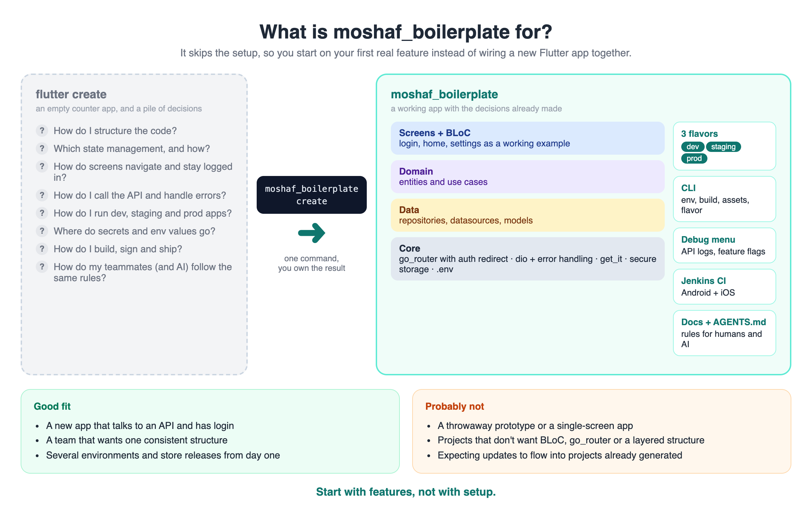
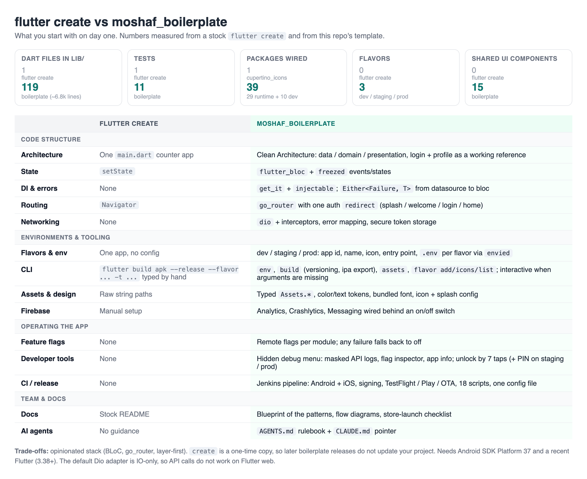
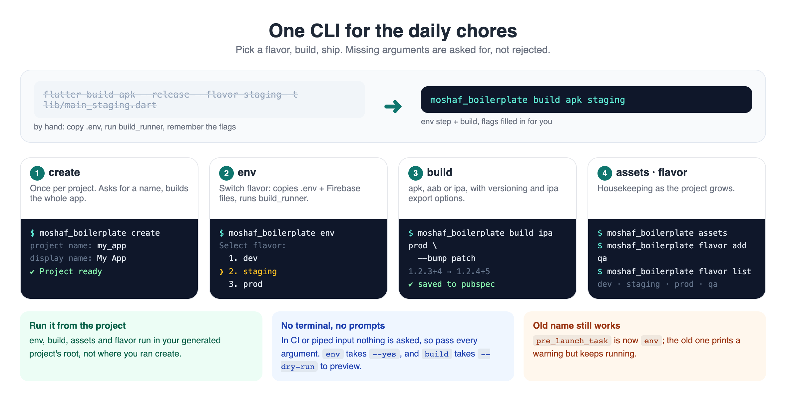
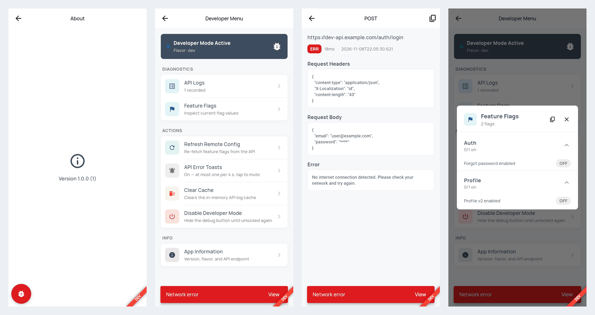

# Flutter Boilerplate


This repository provides a boilerplate source code to streamline the initial setup of new Flutter projects. Developed by moshafDEV, it ensures consistency, scalability, and adherence to best practices through Clean Architecture principles.



<details>
<summary>Detailed comparison with a plain <code>flutter create</code></summary>



</details>

## Features

- Clean Architecture structure for maintainability and scalability
- Modular codebase for rapid development
- Pre-configured assets and essential directories
- Ready-to-use templates for common features
- One CLI for day-to-day work — `env` (switch flavor config), `build` (apk/aab/ipa with versioning), `assets`, `flavor`; interactive when arguments are missing, see [CLI Commands](#cli-commands)
- Integrated support for multiple environments using [`flutter_flavor`](https://pub.dev/packages/flutter_flavor) — `dev`/`staging`/`prod` out of the box, `moshaf_boilerplate flavor add <name>` scaffolds new ones (e.g. qa)
- State management with [`flutter_bloc`](https://pub.dev/packages/flutter_bloc)
- Dependency injection via [`get_it`](https://pub.dev/packages/get_it) + [`injectable`](https://pub.dev/packages/injectable)
- Networking powered by [`dio`](https://pub.dev/packages/dio)
- Local storage setup with [`flutter_secure_storage`](https://pub.dev/packages/flutter_secure_storage)
- Declarative navigation via [`go_router`](https://pub.dev/packages/go_router) — a single `redirect` gates the auth flow (splash/welcome/login/home), with a reporting `errorBuilder` for unmatched routes
- Type-safe asset access — `moshaf_boilerplate assets` scans `assets/` and generates `Assets.images.xxx`/`Assets.svg.xxx` constants, no `flutter_gen` dependency needed
- Linting and code quality enforced with [`flutter_lints`](https://pub.dev/packages/flutter_lints)
- Unit and widget testing configuration
- Customizable theme and localization support
- Error handling and logging modules, wired into both crash reporting and routing
- Analytics integration for screen tracking
- Example implementation for authentication (login/profile)
- Separation of data, domain, and presentation layers
- Configurable environment variables and DI modules
- AI-agent ready — `AGENTS.md` (+ `CLAUDE.md`) gives Claude Code/Cursor/Codex the project's working rules, backed by `PROJECT_BLUEPRINT.md`
- Ready-to-adapt Jenkins CI pipeline (`Jenkinsfile` + `ci/`) for Android + iOS staging/production builds
- Internal developer tools, hidden from normal users — tap the Welcome/Login logo to reach a hidden About page, tap the app version 7 times to unlock (auto-on in `dev`) a draggable floating debug button opening a menu with a masked API log viewer, feature flag inspector, and app info; see [Developer Tools](#developer-tools)

## Installation Guide

Follow these steps to install `moshaf_boilerplate` globally using Dart Pub:

1. **Install Dart SDK**  
   Ensure Dart SDK is installed on your system.  
   Refer to the official guide: [dart.dev/get-dart](https://dart.dev/get-dart).

2. **Open Terminal or Command Prompt**  
   Use your preferred terminal (Linux/Mac) or Command Prompt (Windows).

3. **Run Installation Command**  
   Execute the following command to install `moshaf_boilerplate` globally:
   ```bash
   dart pub global activate moshaf_boilerplate
   ```

4. **Verify Installation**  
   Confirm the installation by running:
   ```bash
   moshaf_boilerplate --help
   ```
   If help information is displayed, the installation was successful.

5. **Add Dart Pub Global Path (if required)**  
   If the command is not recognized, add Dart's global pub path to your environment variables:
   - **Linux/Mac:** `$HOME/.pub-cache/bin`
   - **Windows:** `%USERPROFILE%\.pub-cache\bin`

   Example for Linux/Mac:
   ```bash
   export PATH="$PATH:$HOME/.pub-cache/bin"
   ```

## Usage Guide

Once installation is complete, follow these steps to initialize your Flutter project using `moshaf_boilerplate`:

1. **Open CLI in Your Workspace Directory**  
   Navigate to the folder where you keep your projects (e.g. `~/dev`) — not a folder named after the project itself.

2. **Run the Boilerplate Creation Command**  
   Execute the following command:
   ```bash
   moshaf_boilerplate create
   ```
   You'll be prompted for a project name (a valid Dart package identifier — lowercase, `snake_case`) and then an app display name (press Enter to derive one from the project name, e.g. `moshaf_app` → `Moshaf App`). A new folder named after the project name is created right there with the full Clean Architecture structure and templates inside it — nothing outside that new folder is touched.

> **Updates are not automatic.** `create` is a one-time copy: a new boilerplate release does not change projects you already generated. Read the [CHANGELOG](https://github.com/moshafDEV/moshaf_boilerplate/blob/main/CHANGELOG.md) and port what you want.

> **Note:**  
> After generating your project, it is highly recommended to review and customize your `.gitignore` file to ensure that unnecessary files and directories are excluded from version control. This helps maintain a clean repository and prevents accidental commits of sensitive or build-related files.

## CLI Commands



Run `moshaf_boilerplate help` for the list, or `moshaf_boilerplate help <command>` (or `<command> --help`) for details.

| Command | What it does |
| --- | --- |
| `create` | Generate a new project (run from your workspace folder) |
| `env [flavor]` | Copy `.env.<flavor>` → `.env` (+ the flavor's `GoogleService-Info` plist), then optionally run `build_runner` |
| `build [apk\|aab\|ipa] [flavor]` | `env` step, then `flutter build` with the right `--flavor` / `-t lib/main_<flavor>.dart` |
| `assets` | Regenerate typed asset constants |
| `flavor add\|icons\|list` | Scaffold a flavor, draw ribboned icons, list flavors |
| `version` | Show the generator version |

Run project commands (`env`, `build`, `assets`, `flavor`) from the **generated project's root**, not from where you ran `create`.

**Missing arguments are asked for, not rejected.** `moshaf_boilerplate env` lists the flavors it finds as `.env.*` files and lets you pick with ↑/↓ and Enter; `build` asks for target, flavor, version, and (ipa) export method. A mistyped flavor gets a "did you mean" hint. Without a terminal (CI, piped input) nothing is asked — pass every argument explicitly, or the command exits with an error.

### `env`

```bash
moshaf_boilerplate env                 # pick a flavor
moshaf_boilerplate env staging --yes   # run build_runner without asking
moshaf_boilerplate env prod --no-build # only copy files, skip build_runner
```

### `build`

```bash
moshaf_boilerplate build                              # interactive
moshaf_boilerplate build apk staging
moshaf_boilerplate build aab prod --bump patch        # 1.2.3+4 → 1.2.4+5, saved to pubspec after success
moshaf_boilerplate build aab prod --build-name 1.4.0 --build-number 42 --save
moshaf_boilerplate build ipa staging --export-method ad-hoc
moshaf_boilerplate build apk dev --dry-run -- --verbose
```

- Uses `fvm flutter` when FVM works for the project, otherwise plain `flutter`.
- The env step also runs `build_runner` (slow, but it regenerates `envied` output for the selected flavor); `--no-codegen` skips it, `--no-env` skips the whole step.
- **Versioning:** `--build-name`/`--build-number` affect that build only and leave `pubspec.yaml` untouched. `--bump major|minor|patch|build` (build number always +1) and `--save` write the new `version:` to `pubspec.yaml`, only after the build succeeds.
- **ipa** needs macOS and an Xcode with your Apple ID/team already signed in (automatic signing). `--export-method app-store|ad-hoc|development|enterprise` (default `app-store`); `--no-codesign` archives without signing. A warning is shown if no signing identity is in the keychain — that's normal when Xcode manages signing for you. If automatic signing fails on provisioning, open the project in Xcode once.
- `--obfuscate` stores symbols in `build/symbols/<flavor>` — keep them, they're needed to symbolicate crash reports.
- `--debug`/`--profile`, `--split-per-abi` (apk), `--dry-run`, and `-- <flutter args>` passthrough are supported too.

> **Deprecated:** `moshaf_boilerplate pre_launch_task <flavor>` still works but prints a warning — use `env`. Projects generated by an older version keep `pre_launch_task` in `.vscode/tasks.json`; both work, switch whenever convenient. Newly generated projects use `env`, which needs this CLI version or newer installed (`dart pub global activate moshaf_boilerplate`).

## Running on macOS

macOS builds need one manual, per-machine step that no CLI generator can do
for you: `flutter_secure_storage` uses Keychain, which under App Sandbox
requires a real signing identity. After generating your project:

1. Open `macos/Runner.xcworkspace` in Xcode.
2. Select **Runner** → **Signing & Capabilities**.
3. Pick your Team (a personal Apple ID works for local development).

Without this, `flutter run -d macos` fails to build with `"Runner" has
entitlements that require signing with a development certificate.` Android
and iOS don't need this step.

## Flavors (Android & iOS)

`dev`, `staging`, and `prod` flavors — application id/bundle id, display name,
app icon, launch screen — are set up automatically at generation time by
[`flutter_flavorizr`](https://pub.dev/packages/flutter_flavorizr), driven by
`flavorizr.yaml` at the project root. No manual Xcode configuration-duplication
or Gradle editing is required; `flutter run --flavor dev -t lib/main_dev.dart`
(or `staging`/`prod`) works right after generation.

### Adding a new flavor

```bash
moshaf_boilerplate flavor add qa
```
Registers the flavor in the `Flavor` enum, scaffolds `lib/main_qa.dart`,
appends a block to `flavorizr.yaml`, creates a starter `.env.qa`, and adds a
matching VS Code task — then prints the exact next steps (review the
generated `applicationId`/`bundleId`, optionally drop in Firebase config,
then run `flutter_flavorizr` yourself; see below). It does not run
`flutter_flavorizr` for you, since that regenerates native config for every
flavor at once and is worth reviewing before it lands.

### Changing an existing flavor

Edit `flavorizr.yaml`, then re-run:
```bash
dart run flutter_flavorizr -f
```
This only touches native Android/iOS flavor config (application id, bundle
id, app name, icons, launch screen) — it never touches `lib/`, so your own
Dart code (including `main_dev.dart`/`main_prod.dart` and this boilerplate's
`flutter_flavor`-based `FlavorConfig`) is untouched.

### Adding your Firebase config per flavor

Firebase config files are secrets and can't be templated, so add them
yourself, then point `flavorizr.yaml` at them:

- **Android**: place `google-services.json` in `android/app/src/dev/` (and
  `.../staging/`, `.../prod/`), then uncomment the matching `firebase.config`
  line under that flavor in `flavorizr.yaml`.
- **iOS**: place `GoogleService-Info.plist` wherever you like in the repo
  (e.g. `ios/config/dev/GoogleService-Info.plist`), then uncomment and point
  the matching `firebase.config` line to it.

Re-run `dart run flutter_flavorizr -f` afterwards to wire them in.

## App Icon & Splash Screen

Config for [`flutter_launcher_icons`](https://pub.dev/packages/flutter_launcher_icons) and
[`flutter_native_splash`](https://pub.dev/packages/flutter_native_splash) ships as
`flutter_launcher_icons.yaml`/`flutter_native_splash.yaml` at the project root (both
auto-detected by their default filename, no extra flag needed). They point at placeholder
image paths — drop in your own icon/splash images at those paths, then run:
```bash
dart run flutter_launcher_icons
dart run flutter_native_splash:create
```
Neither runs automatically at generation time, since there's no real app icon to generate
from yet.

### Flavor-ribboned icons

Once you've dropped in a real icon:
```bash
moshaf_boilerplate flavor icons
dart run flutter_launcher_icons
```
Draws a red "DEV"/"STAGING" ribbon across the bottom of the icon for those two flavors
(same red as the in-app flavor banner) and writes matching
`flutter_launcher_icons-dev.yaml`/`-staging.yaml`/`-prod.yaml` files — `flutter_launcher_icons`
picks up all three on its own. prod gets an unribboned copy of the config, deliberately: the
moment any flavor-specific config file exists, `flutter_launcher_icons` stops processing the
base config entirely, so prod needs its own file too or its icon silently stops regenerating.

## Type-Safe Assets

`moshaf_boilerplate assets` scans `assets/` and (re)writes
`lib/core/constants/assets.gen.dart` — one generated class per top-level folder
(`Assets.images.imgLanding`, `Assets.svg.iconSearch`, ...), plain `String` constants, no
`flutter_gen`/`build_runner` dependency. Runs once automatically at generation time; re-run
it yourself any time you add or remove files under `assets/` (also available as a VS Code
task, "Regenerate Assets").

## Feature Flags

A remote-config-backed feature flag system (`lib/core/feature_flags/`, `lib/domain/entities/feature_flags/`) — a global `ChangeNotifier` (`FeatureFlagNotifier`, exposed via `provider`) fetched once at startup from `GET <API_URL>/v1/config/feature-flags`, with state grouped per module (`auth`, `profile` out of the box) so each module only ever reads its own flags. Any failure (timeout, malformed response) falls back to every flag off, silently — a broken flags endpoint degrades the app, it never crashes it or surfaces an error. See `password_input_field.dart`'s "Forgot Password" button for a working example of gating UI on a flag.

To add a new flag: create a `<Module>FeatureFlags` entity under `domain/entities/feature_flags/`, add a field for it on `FeatureFlagState`, and add its key under `fromJson` — existing modules are untouched.

## Developer Tools

An Android-Developer-Options-style debug layer, invisible to normal users — no visible button anywhere until it's unlocked.



**Unlocking it**: tap the logo on the Welcome or Login page (it looks like a plain logo, not a button — that's the point) to open the About page, no login required. From there:

- **`dev`**: already on automatically — the tap just gets you to About, nothing to unlock.
- **`staging`**: tap the app version 7 times, then the same PIN dialog as prod (`DEVELOPER_PIN`; unset means no PIN is enforced, so the tap alone unlocks); shows "Developer mode enabled".
- **`prod`**: same as staging — 7 taps, then a PIN dialog (`DEVELOPER_PIN` in `.env` — unset means no PIN is enforced, so the tap alone unlocks; see `developer_pin_gate.dart`).

Once unlocked, a draggable floating button (`lib/core/developer_tools/`) appears on every page except the developer-tools screens themselves — drag it anywhere, it stays within screen bounds and keeps its position for the rest of the app session (not persisted across restarts). Tapping it opens the Developer Menu:

- **API Logs** — every request/response Dio makes, while developer mode is on only, capped at 100 (newest first). Sensitive values (`Authorization`/`Cookie` headers; `password`, `token`, `otp`, `id_token` and similar body fields) are masked before they're ever stored; `ResponseType.bytes` bodies that hold JSON are decoded and masked too, other binary bodies show as `(binary, N bytes)`. Tap an entry for full request/response detail, with a copy-response button; a failed call (>=400 or network error) also raises a snackbar with a direct link to its log — at most one per 4 seconds (extra failures show as "+N more"), and it can be muted with the **API Error Toasts** tile in the menu (failures are still logged).
- **Feature Flags** — current state of the [feature flag system](#feature-flags) below, grouped per module in a scrollable accordion; a "copy expected response" button copies the exact JSON (and endpoint) a working backend should return for the current flag set.
- **Refresh Remote Config** — re-fetches feature flags from the API.
- **Clear Cache** — clears the in-memory API log store.
- **App Information** — app name, version/build number, flavor, API base URL.
- **Disable Developer Mode** — hides the floating button until unlocked again (on `dev` it comes back after the next app restart, since `dev` enables itself at startup).

To expose the unlock gesture somewhere else, wrap any widget in `DeveloperModeUnlockTrigger` (`core/developer_tools/`) — it holds the whole tap-count → PIN → enable flow, so `AboutPage` is just one user of it.

`ApiLoggerInterceptor` is wired into `MainClient` alongside the existing `PrettyDioLogger`/`CustomInterceptor` — it self-gates on `DeveloperModeNotifier.isEnabled` at request time, so nothing is recorded while developer mode is off, no matter how the interceptor got attached.

## Continuous Integration (Jenkins)

A ready-to-adapt Jenkins pipeline ships as `Jenkinsfile` + `ci/` — builds, signs, and ships
Android and iOS for `staging`/`production` branches, with optional TestFlight/Play
Store/OTA distribution. Every project-specific value (credential IDs, agent labels, bundle
IDs) lives in one file, `ci/config.groovy`; `Jenkinsfile` and `ci/scripts/*.sh` stay
untouched. Start with `ci/docs/CREDENTIALS_GUIDE.md`, then `ci/docs/RUN-PIPELINE.md` to test
locally before wiring it into Jenkins. Not using Jenkins? Delete `Jenkinsfile` and `ci/` —
nothing else in the project depends on them.

## Store Launch Checklist

`docs/release/store-launch-checklist.html` is a single, offline, no-build-step HTML file — double-click to open it. It ships a fixed 60-point App Store/Google Play release checklist (with a copyable privacy policy template) and two normally-empty tabs, Audit and Reference, that a Claude Code prompt (documented in `docs/release/README.md`) fills in by inspecting this specific repository (manifests, plists, gradle files, entitlements, permission code) and writes back into the same file. The interface and content switch between English and Indonesian from a toggle in the top bar. Not needed? Delete `docs/release/` — nothing else depends on it.

---

## Directory Structure Overview

> **Note:** The following diagram illustrates the recommended folder structure, demonstrating clear separation of concerns in accordance with Clean Architecture.

```
├── AGENTS.md                     # working rules for AI agents (CLAUDE.md points to it)
├── PROJECT_BLUEPRINT.md          # code standard — read before adding a feature
├── ci                            # Jenkins pipeline scripts/docs (optional, deletable)
├── docs
│   └── release                   # store-launch-checklist.html — offline release checklist (optional, deletable)
├── Jenkinsfile
├── flavorizr.yaml
├── flutter_launcher_icons.yaml
├── flutter_native_splash.yaml
├── .env.dev / .env.staging / .env.prod   # starter files, placeholder values only
├── assets
│   ├── fonts
│   ├── images
│   ├── svg
│   └── translations
├── build.yaml
├── config.json
├── lib
│   ├── app.dart
│   ├── core
│   │   ├── analytics
│   │   │   └── screen_analytics
│   │   ├── config
│   │   │   ├── di_module
│   │   │   └── loggers
│   │   ├── constants                # colors.dart, textstyle.dart, generated assets.gen.dart
│   │   ├── developer_tools          # hidden debug menu — see Developer Tools below
│   │   │   ├── api_logs
│   │   │   ├── components           # shared menu section/tile widgets
│   │   │   └── dialogs
│   │   ├── env
│   │   ├── error
│   │   ├── feature_flags            # FeatureFlagApi, FeatureFlagNotifier
│   │   ├── http_client
│   │   │   ├── interceptors         # incl. ApiLoggerInterceptor
│   │   ├── routes                   # app_router.dart (GoRouter), app_routes.dart, app_path.dart
│   │   ├── services
│   │   └── utils
│   ├── data
│   │   ├── datasources
│   │   │   ├── local
│   │   │   └── remote
│   │   ├── models
│   │   │   ├── login
│   │   │   │   ├── request
│   │   │   │   └── response
│   │   │   └── profile
│   │   │       └── response
│   │   └── repository_impls         # incl. feature_flag_repository_impl.dart
│   ├── domain
│   │   ├── entities
│   │   │   ├── auth
│   │   │   ├── feature_flags        # FeatureFlagState + one entity per module
│   │   │   ├── general_data_list
│   │   │   ├── login_param
│   │   │   ├── profile
│   │   │   └── text_input_field
│   │   ├── repositories
│   │   └── usecase
│   │       └── login
│   └── presentation
│       ├── bloc
│       │   └── login
│       ├── components                # shared widgets: chip, dialog, avatar, switch, ...
│       └── pages
│           ├── forgot_password
│           ├── home
│           │   ├── components
│           ├── login
│           │   ├── components
│           ├── register
│           ├── settings              # about_page.dart — hidden developer-tools entry point
│           ├── splash_screen
│           │   ├── components
│           └── welcome
│               ├── components
```

## Recommended Versions

For best compatibility and performance, use the following versions:

- **Flutter: >= 3.38.0**
  Check your version:
  ```bash
  flutter --version
  ```

- **Dart: >= 3.9.0**
  Check your version:
  ```bash
  dart --version
  ```

- **Android SDK Platform 37** (or whatever `compileSdk`'s floor in the generated `android/app/build.gradle.kts` currently is) — required by `flutter_secure_storage`, which Flutter's own default `compileSdk` doesn't match yet regardless of which Flutter version you use. Install it once via Android Studio's SDK Manager, or:
  ```bash
  sdkmanager "platforms;android-37"
  ```

Refer to the official Dart installation guide: [https://dart.dev/get-dart](https://dart.dev/get-dart).

After installation, ensure the Dart SDK path is added to your system's environment variables.  
Example for macOS/Linux:
```bash
export PATH="$PATH:/usr/local/bin/dart"
```
On Windows, add the Dart SDK path (e.g., `C:\tools\dart-sdk\bin`) to your system's PATH variable.

## References

- [Dart Pub Documentation](https://dart.dev/tools/pub/cmd/pub-global)
- [moshaf_boilerplate Package](https://pub.dev/packages/moshaf_boilerplate)

## Authors

- [@moshaf](https://github.com/moshafDEV)
