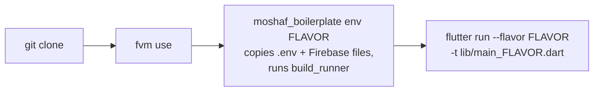
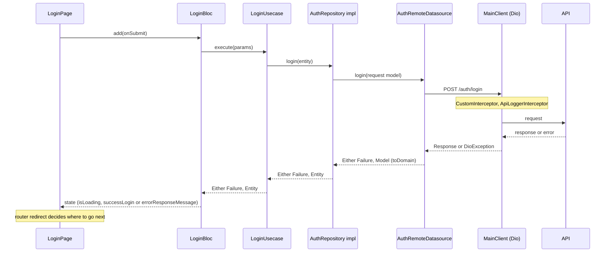

# ProjectDisplayName

A Flutter app generated from [`moshaf_boilerplate`](https://pub.dev/packages/moshaf_boilerplate): Clean Architecture, BLoC, `go_router`, and dev / staging / prod flavors. How the code is organised is in [`PROJECT_BLUEPRINT.md`](./PROJECT_BLUEPRINT.md); rules for AI agents are in [`AGENTS.md`](./AGENTS.md).

## Quick Start



Generated files (`*.g.dart`, `*.freezed.dart`, `*.config.dart`) and `.env` are git-ignored, so a fresh clone **does not compile until step 3** has run. Run `moshaf_boilerplate env` with no flavor to pick one from a list.

Needs the [`moshaf_boilerplate`](https://pub.dev/packages/moshaf_boilerplate) CLI (`dart pub global activate moshaf_boilerplate`), FVM or a matching Flutter, and Android SDK Platform 37 (`sdkmanager "platforms;android-37"`; required by `flutter_secure_storage`).

## Commands

Run from this project's root. Missing arguments are asked for interactively (not in CI: pass them explicitly).

| Command | What it does |
|---|---|
| `moshaf_boilerplate env [flavor]` | Switch `.env` and Firebase files to a flavor, then run `build_runner` |
| `moshaf_boilerplate build [apk\|aab\|ipa] [flavor]` | `env` + `flutter build` with the right `--flavor` and entry point |
| `moshaf_boilerplate assets` | Regenerate typed `Assets.*` constants after adding or removing files in `assets/` |
| `moshaf_boilerplate flavor add\|icons\|list` | Add a flavor, draw ribboned icons, list flavors |

```bash
moshaf_boilerplate build apk staging
moshaf_boilerplate build ipa prod --bump patch    # raises pubspec version, saved after a successful build
moshaf_boilerplate build ipa staging --export-method ad-hoc
```

`--dry-run` prints the commands first; `moshaf_boilerplate build --help` lists every option. `--build-name`/`--build-number` change that build only, while `--bump` and `--save` also write `version:` in `pubspec.yaml`. `build ipa` needs macOS with Xcode signed in to your Apple ID/team; if signing fails on provisioning, open `ios/Runner.xcworkspace` in Xcode once. (`pre_launch_task` is the deprecated old name of `env`.)

## Flavors

| | `dev` | `staging` | `prod` |
|---|---|---|---|
| Entry point | `lib/main_dev.dart` | `lib/main_staging.dart` | `lib/main_prod.dart` |
| Env file | `.env.dev` | `.env.staging` | `.env.prod` |
| App name | `ProjectDisplayName [DEV]` | `ProjectDisplayName [STAGING]` | `ProjectDisplayName` |
| applicationId / bundleId | `com.example.ProjectName.staging` | `com.example.ProjectName.staging` | `com.example.ProjectName` |
| Developer Tools | on at startup | 7 taps + PIN | 7 taps + PIN |

`dev` and `staging` share one id on purpose: a device holds one of them at a time. `envied` bakes `.env` into `env.g.dart` at build time, so switching flavor means re-running `env`. Changed `flavorizr.yaml`? Run `dart run flutter_flavorizr -f`.

## How a Request Flows

The login feature is the reference. A layer never skips another layer.



A new feature is this chain written bottom-up: `ApiPath` → model → datasource → repository → entity → usecase → bloc → page (`PROJECT_BLUEPRINT.md` §4).

## Good to Know

- **Developer Tools** (hidden debug menu: masked API logs, feature flags, app info). Tap the logo on Welcome/Login to reach About, then the version 7 times (plus `DEVELOPER_PIN` on staging/prod; `dev` is always on). Details: blueprint §11.
- **Feature flags** are fetched from `GET <API_URL>/v1/config/feature-flags`, grouped per module, and fall back to off on any failure. Adding one: blueprint §12.
- **App icon and splash:** replace the placeholder images referenced by `flutter_launcher_icons.yaml` / `flutter_native_splash.yaml`, then `dart run flutter_launcher_icons` and `dart run flutter_native_splash:create`.
- **CI:** `Jenkinsfile` + `ci/` build and ship Android/iOS; every project value lives in `ci/config.groovy`. Start with `ci/docs/CREDENTIALS_GUIDE.md`. Not using Jenkins? Delete both.
- **Store launch checklist:** open `docs/release/store-launch-checklist.html` (offline, no build step). Not needed? Delete `docs/release/`.
